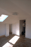
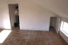
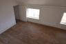
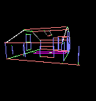
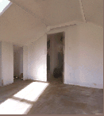

# Photogrammetry and 3-D Scene Reconstruction for Interactive Model-Based Video

  

<!-- SUMMARY:START generated from workspace-linkedin-profile/Projects.json by scripts/build_readme_header.py; edit there -->
A semi-automated process that uses multiple photographs of a scene to create a textured 3-D model for interactive model-based video. MIT Media Laboratory doctoral research, 1997: parallel and coplanar edges marked across uncalibrated views are used to estimate each camera's focal length, position, and orientation, recover piecewise-planar scene geometry, and map photograph texture onto that model as a VRML scene that can be re-rendered from new viewpoints.

**Web page:** [https://alumni.media.mit.edu/~sbeck/index.html](https://alumni.media.mit.edu/~sbeck/index.html)\
**Thesis:** [https://dspace.mit.edu/handle/1721.1/29123](https://dspace.mit.edu/handle/1721.1/29123)

**Skills:** Computer Vision · Photogrammetry · 3D Scene Reconstruction · Structure from Motion · Camera Calibration · Projective Geometry · Model-Based Video · Computer Graphics · 3D Data Visualization · Algorithms · Automated Software Testing (JUnit/Jest/Vitest/PyTest)
<!-- SUMMARY:END -->

Research by Shawn Becker, Ph.D., MIT Media Laboratory, 1997. A semi-automated process that uses multiple photos of a scene to quickly create a textured 3-D model which can be used for interactive model-based video.

Source: [alumni.media.mit.edu/~sbeck](https://alumni.media.mit.edu/~sbeck/index.html)

## Scene acquisition

The work has two parts. The first is scene acquisition. With a small amount of help from the user, the computer recovers the geometry and texture of surfaces from still photos or individual frames of video. The interface stays simple; the power comes from photogrammetry. The recovered model can be viewed in an ordinary rendering package. The audience for that model is architecture and design, digital effects for film, and virtual reality and telepresence.

Acquisition is the hard part. An ordinary feature, such as the tip of a light switch on the back wall, is difficult for a machine to follow through a video sequence, and pixels of the room are difficult to separate from pixels of an actor. Bootstrapping at scene creation gives later tracking and actor segmentation a model to work from. When the goal is unknown but structured geometry and surface texture from existing images, photorealism and correctness come before full automation.

## Model-based video

The second part uses that acquired model as the basis for low-bandwidth 3-D video. A few images recover the room. Live action is then filmed in that room with a moving camera. The movie is encoded as one static 3-D scene model, seven camera-parameter numbers per frame, and a separate masked 2-D video sequence of the actors. The description is inherently 3-D, so a later viewer can move a virtual camera and inspect the scene, and it is aimed at a much smaller stream than MPEG at 1.5 megabits per second.

That split matches the VRML idea of a static object plus a dynamic stream. The open problem the thesis takes on is acquisition.

## How a view becomes a model

Given one or more views of a static scene, and preselected sets of parallel and coplanar edges, the method recovers view-invariant scene information: 3-D geometry, surface texture, and the cameras that made the views. So far that covers camera parameters, planar 3-D geometry, and surface texture. The scene description is a VRML file.

The user builds an "origami scene": polyhedral surfaces whose hinge lines are visible, with parallelism, orthogonality, and planarity marked among the key lines and points. Two programs do that markup. **sceneBuild** is an X11 tool; Matt Lennon and Bill Butera wrote its tutorial. **ModelMaker** is a later Motif and Open Inventor version by Eugene Lin.

**sceneAnalyze** takes the 2-D origami model and estimates the camera's internal geometry, each camera's position and orientation, and the 3-D geometry of the surfaces. Under test conditions, polygonal geometry of piecewise-rectangular objects was recovered to better than 0.5% dimensional accuracy from uncalibrated views. Later work with Eugene Lin extended the same setup toward generalized cylinders and free-form surfaces.

## This room

The photographs above are three of seven overlapping views of one room, shot with a hand-held uncalibrated camera of unknown lens and focal length. Focal length, position, and rotation differ across the views.

Point and line features are marked by hand and grouped across views into parallel and coplanar sets. A least-squares fit estimates focal length, world-relative rotation, and position for each view. For this scene the image center is the principal point, and lens distortion is treated as negligible. With more edge information those parameters can be estimated as well; that calibration is the separate [lens distortion](https://github.com/sbecker11/lens-distortion-estimation) result.

Polygon extent is then estimated by projecting the calibrated features into the scene. Textures are sampled from the photographs according to which surface was visible in which view. Any viewpoint, including the original cameras, can be synthesized by texture rendering.

Wireframe of the recovered room:

The same model with photograph texture mapped onto it, re-rendered from new viewpoints:

The 1996 update on the original result page notes two fixes that came after the first renders: fading each source image toward transparency at its edges, which removes the patchwork where one photo ends and the next begins, and an iterative downhill simplex search that refines surface and camera parameters by minimizing mis-alignment of visible points and lines.

The modeling package is three programs, **sceneBuild**, **sceneAnalyze**, and **sceneView**, scripted in Tcl with Xlib drawing. Menus are small Tk applications that talk over Tk's send protocol.

## Dissertation

The dissertation is [*Vision-assisted modeling for model-based video representations*](https://dspace.mit.edu/handle/1721.1/29123), Shawn C. Becker, advised by V. Michael Bove, Jr., Program in Media Arts and Sciences, Massachusetts Institute of Technology, 1997. A local copy is `mit-dissertationi.pdf`.

Selected papers from the research page:

- Shawn Becker, *Vision-assisted modeling for model-based video representations*, Ph.D. thesis proposal, MIT, March 1996.
- Shawn Becker and V. Michael Bove, Jr., *Semiautomatic 3-D Model Extraction From Uncalibrated 2-D Camera Views*, SPIE Symposium on Electronic Imaging: Science & Technology, San Jose, February 5–10, 1995.
- Steve Mann and Shawn Becker, *Computation of some projective-chirplet-transform and metaplectic-chirplet-transform subspaces, with applications in image processing*, DSP World Symposium, Boston, November 1992.
- Shawn Becker, William A. Barrett, and Dan R. Olsen, *Interactive Measurement of Three-Dimensional Objects Using a Depth Buffer and Linear Probe*, ACM Transactions on Graphics, Vol. 10, No. 2, April 1991.

## Keywords

Computer vision, image processing, line detection, center of projection, image center, focal length, 3-D sphere of plane normals, orthogonality, covariance-based weighting, clutter avoidance, planar clustering, multi-sample fusion, parallel lines, vanishing points, distortion modeling, simplex cost minimization, interior camera modeling, photogrammetry, scene-relative camera orientation and position, error sensitivity, circle of confusion, inverse texture mapping, computer graphics, texture mapping, feature detection, feature tracking, camera path interpolation, model-based video coding, video compression, MPEG-4 multimedia layers, multi-layered audio and video, 3-D scene model, 3-D camera position, 3-D camera orientation, camera zoom, 3-D audio sources, lighting, actors, objects, two-way internet communications, interactive video, interactive virtual camera and scene manipulation.