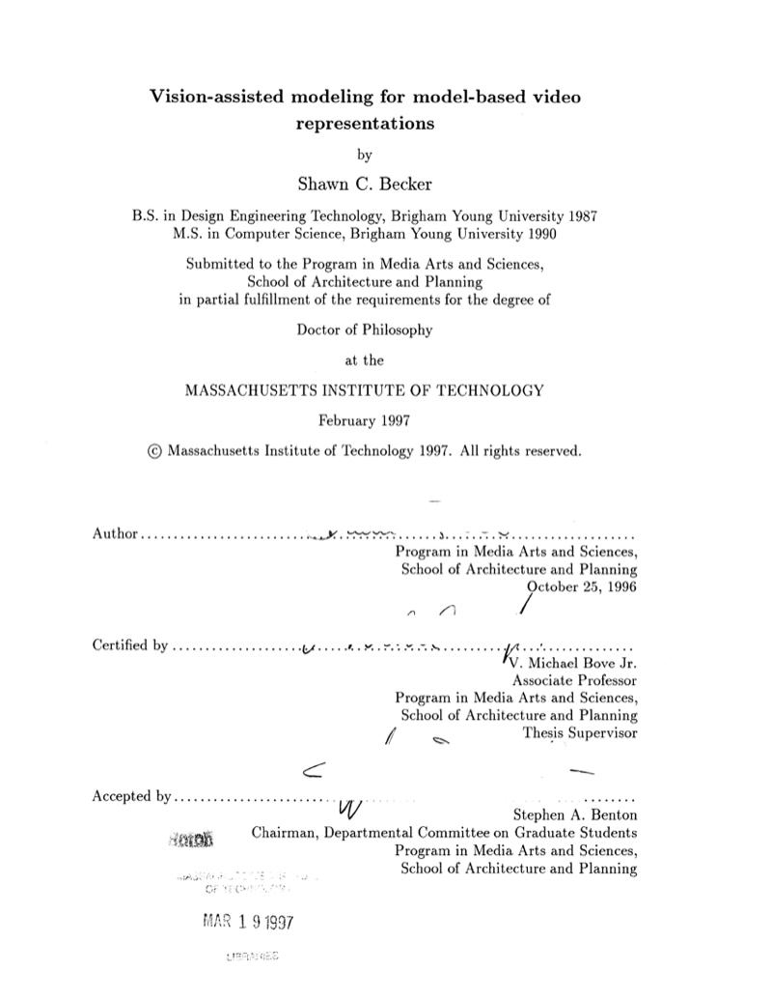

# Shawn Becker — Research at the MIT Media Laboratory

  

<!-- SUMMARY:START generated from workspace-linkedin-profile/Projects.json by scripts/build_readme_header.py; edit there -->
A semi-automated process that uses multiple photographs of a scene to create a textured 3-D model for interactive model-based video. MIT Media Laboratory doctoral research, 1997: parallel and coplanar edges marked across uncalibrated views are used to estimate each camera's focal length, position, and orientation, recover piecewise-planar scene geometry, and map photograph texture onto that model as a VRML scene that can be re-rendered from new viewpoints.

**Skills:** Computer Vision · Photogrammetry · 3D Scene Reconstruction · Structure from Motion · Camera Calibration · Projective Geometry · Model-Based Video · Computer Graphics · 3D Data Visualization · Algorithms · Automated Software Testing (JUnit/Jest/Vitest/PyTest)
<!-- SUMMARY:END -->

This repository documents two pieces of research from the MIT Media Laboratory. They came out of the same lab and both deal with how a camera's geometry shows up in an image, but they are otherwise independent and can be read separately.

| | Work | Year | Form |
|---|---|---|---|
| [Part 1](#part-1--vision-assisted-modeling-for-model-based-video) | Vision-assisted modeling for model-based video | 1997 | Ph.D. dissertation, advised by V. Michael Bove, Jr. |
| [Part 2](#part-2--projective-and-metaplectic-chirplet-transform-subspaces) | Projective and metaplectic chirplet-transform subspaces | 1992 | Conference paper with Steve Mann, DSP World Symposium |

Original research page: [alumni.media.mit.edu/~sbeck](https://alumni.media.mit.edu/~sbeck/index.html)

---

## Part 1 — Vision-assisted modeling for model-based video

A semi-automated process that turns a few photographs of a scene into a textured 3-D model, and then uses that model as the basis for low-bandwidth, interactive 3-D video.

### The problem

The work has two halves.

**Scene acquisition.** With a small amount of help from the user, the computer recovers the geometry and texture of surfaces from still photos or individual video frames. The interface stays simple; the power comes from photogrammetry. The recovered model can be viewed in an ordinary rendering package, which makes it useful for architecture and design, film effects, and virtual reality and telepresence.

Acquisition is the hard part. An ordinary feature, such as the tip of a light switch on the back wall, is difficult for a machine to follow through a video sequence, and pixels of the room are difficult to separate from pixels of an actor. Building a model of the scene first gives later tracking and actor segmentation something to work from. When the goal is accurate geometry and texture from existing images, photorealism and correctness come before full automation.

**Model-based video.** A few images recover the room. Live action is then filmed in that room with a moving camera. The movie is encoded as one static 3-D scene model, seven camera-parameter numbers per frame, and a separate masked 2-D video sequence of the actors. Because the description is inherently 3-D, a viewer can later move a virtual camera through the scene, and the stream is aimed to be much smaller than MPEG's 1.5 megabits per second. That split mirrors the VRML idea of a static object plus a dynamic stream. The open problem the thesis takes on is acquisition.

### Method

Given one or more views of a static scene, and user-selected sets of parallel and coplanar edges, the method recovers view-invariant scene information: the cameras that made the views, piecewise-planar 3-D geometry, and surface texture. The output is a VRML scene.

1. **Mark up an "origami scene."** The user outlines polyhedral surfaces whose hinge lines are visible and marks parallelism, orthogonality, and planarity among the key lines and points.
2. **Calibrate the cameras.** A least-squares fit estimates each view's focal length, world-relative rotation, and position from the grouped edges, without a calibrated camera.
3. **Recover geometry.** Calibrated features are projected into the scene to estimate the extent of each polygon.
4. **Map texture.** Each surface is textured from the photographs in which it was visible, so any viewpoint, including the original cameras, can be re-rendered.

Under test conditions, polygonal geometry of piecewise-rectangular objects was recovered to better than 0.5% dimensional accuracy from uncalibrated views. Later work with [Eugene Lin](https://www.linkedin.com/in/eugeneismyname/) extended the same setup toward generalized cylinders and free-form surfaces.

A 1996 update added two refinements: fading each source image toward transparency at its edges, which removes the patchwork where one photo ends and the next begins, and an iterative downhill simplex search that refines surface and camera parameters by minimizing misalignment of visible points and lines.

### Worked example: one room

The photographs at the top of this page are three of seven overlapping views of one room, shot with a hand-held camera of unknown lens and focal length. Focal length, position, and rotation differ across the views. For this scene the image center is taken as the principal point and lens distortion is treated as negligible; with more edge information both can be estimated too (see [lens-distortion-estimation](https://github.com/sbecker11/lens-distortion-estimation)).

Wireframe of the recovered room:

The same model with photograph texture mapped onto it, re-rendered from new viewpoints:

### Software

| Program | Role |
|---|---|
| **sceneBuild** | X11 tool for marking up the origami scene. [Matt Lennon](https://www.linkedin.com/in/matthew-lennon-5aa3411/) and [Bill Butera](https://www.linkedin.com/in/bill-butera-04a313/) wrote its tutorial. |
| **sceneAnalyze** | Estimates internal camera geometry, each camera's position and orientation, and the 3-D surface geometry. |
| **sceneView** | Renders the textured model from new viewpoints. |
| **ModelMaker** | A later Motif and Open Inventor version of the markup tool, by [Eugene Lin](https://www.linkedin.com/in/eugeneismyname/). |

The original three programs are scripted in Tcl with Xlib drawing; menus are small Tk applications that talk over Tk's `send` protocol.

### Dissertation and publications

Shawn C. Becker, [*Vision-assisted modeling for model-based video representations*](https://dspace.mit.edu/handle/1721.1/29123), Ph.D. dissertation, Program in Media Arts and Sciences, Massachusetts Institute of Technology, 1997. Advisor: [V. Michael Bove, Jr.](https://www.linkedin.com/in/v-michael-bove-475126/)

Related papers:

- Shawn Becker, *Vision-assisted modeling for model-based video representations*, Ph.D. thesis proposal, MIT, March 1996.
- Shawn Becker and V. Michael Bove, Jr., *Semiautomatic 3-D Model Extraction From Uncalibrated 2-D Camera Views*, SPIE Symposium on Electronic Imaging: Science & Technology, San Jose, February 5–10, 1995.

---

## Part 2 — Projective and metaplectic chirplet-transform subspaces

Steve Mann and Shawn Becker, *Computation of some projective-chirplet-transform and metaplectic-chirplet-transform subspaces, with applications in image processing*, DSP World Symposium, Boston, November 1992. MIT Media Laboratory.

### Overview

The [chirplet transform](https://en.wikipedia.org/wiki/Chirplet_transform) decomposes a signal into pieces whose frequency can change over time or across space, where a wavelet's frequency is fixed. The full chirplet parameter space is large and expensive to evaluate, so the paper computes selected subspaces of two variants:

- **Projective chirplet transform (PCT).** When a camera views a flat, regular pattern at an angle, the pattern's spatial frequency compresses toward the horizon, which behaves like a chirp. PCT subspaces restricted to paths such as tilt or pan-tilt-zoom relate that compression to camera perspective, which supports perspective correction and estimating camera orientation relative to a ground plane from vanishing points and lines.
- **Metaplectic chirplet transform (MCT).** The metaplectic group, a double cover of the symplectic group, models linear chirps produced by spatial shear, rotation, and quadratic phase. MCT subspaces isolate the local orientation and rate of change of image components without evaluating the whole transform.

### Topics

- Time-frequency analysis of 1-D signals and 2-D images: linear chirps, projective chirps, quadratic phase
- Projective geometry of camera perspective and the projective group SL(3, R)
- Perspective correction, vanishing points and lines, and camera orientation relative to a ground plane
- The metaplectic and symplectic groups, spatial shear, and rotation

---

## Skills and keywords

Computer Vision · Photogrammetry · 3D Scene Reconstruction · Structure from Motion · Camera Calibration · Projective Geometry · Model-Based Video · Computer Graphics · 3D Data Visualization · Image Processing · Algorithms · Chirplet Transform · Time-Frequency Analysis · Projective Chirplet Transform · Metaplectic Chirplet Transform · SL(3, R) · Metaplectic Group · Symplectic Group · Quadratic Phase · Perspective Correction · Vanishing Points · Parallel Lines · Orthogonality · Line Detection · Feature Detection · Feature Tracking · Interior Camera Modeling · Center of Projection · Image Center · Focal Length · Camera Zoom · Distortion Modeling · Scene-Relative Camera Position and Orientation · Camera Path Interpolation · 3D Sphere of Plane Normals · Planar Clustering · Covariance-Based Weighting · Multi-Sample Fusion · Clutter Avoidance · Simplex Cost Minimization · Error Sensitivity · Circle of Confusion · Texture Mapping · Inverse Texture Mapping · Model-Based Video Coding · Video Compression · MPEG-4 Multimedia Layers · Multi-Layered Audio and Video · 3D Scene Models (Cameras, Lighting, Actors, Objects, 3D Audio Sources) · Interactive Video · Interactive Virtual Camera and Scene Manipulation · Two-Way Internet Communications

---

## Earlier work

Before MIT, at Brigham Young University: Shawn Becker, William A. Barrett, and Dan R. Olsen, *Interactive Measurement of Three-Dimensional Objects Using a Depth Buffer and Linear Probe*, ACM Transactions on Graphics, Vol. 10, No. 2, April 1991.
